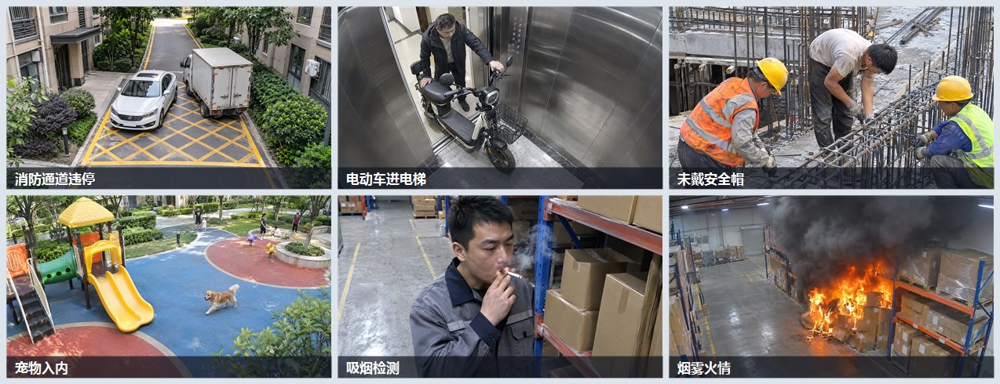
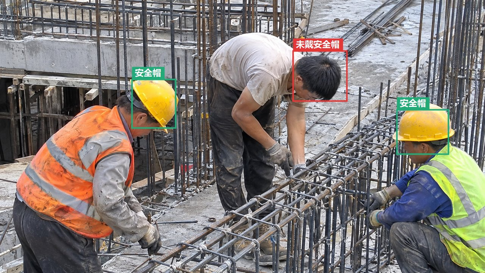
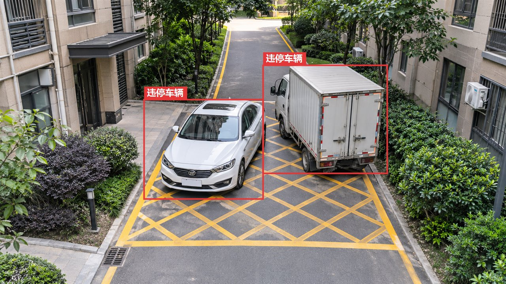

# Wulabel 使用教程

从装好软件到训出能用的模型，一步步走完。整条流程完全在本机离线完成，图片和数据不会离开你的电脑（只有你主动用「巡瞳 AI」辅助标注时，才会把图片发给巡瞳 AI 平台）。

> 在线版同样内容见官网：<https://wulabel.xiaowuiot.com/guide.html>
>
> 想看每个按钮怎么点、一步步的操作，见 [详细操作版](使用教程-详细版.md)。

## 目录

1. [下载与安装](#1-下载与安装)
2. [装训练环境](#2-装训练环境只需一次)
3. [新建项目](#3-新建项目)
4. [导入数据](#4-导入数据)
5. [标注](#5-标注)
6. [AI 辅助标注](#6-ai-辅助标注)
7. [数据体检](#7-数据体检)
8. [划分数据集与数据集版本](#8-划分数据集与数据集版本)
9. [训练与训练对比](#9-训练与训练对比)
10. [评估](#10-评估)
11. [模型预标注](#11-模型预标注)
12. [导出与部署](#12-导出与部署)
13. [反馈问题](#13-反馈问题)

---

## 1. 下载与安装

到官网[下载页](https://wulabel.xiaowuiot.com/#download)或开源仓库的 Release 选最新版本，下载 Windows 安装包（`.msi` / `.exe`）。双击安装，或解压后直接运行。

- **系统要求：** Windows 10 / 11（64 位）。macOS 版本在准备中（Apple 芯片用 MPS 加速训练）。
- **训练：** 建议 NVIDIA 显卡，纯 CPU 也能训，只是慢一些。
- 首次运行若提示缺少 WebView2，按提示装一下即可（大多数 Win10/11 已自带）。

## 2. 装训练环境（只需一次）

第一次要训练前，进入**设置**页点**一键安装训练环境**。软件会自动检测显卡、选择匹配的 PyTorch 版本，并用国内镜像加速下载。

- 可自选安装位置；也可以在设置里**指向一个已有的 Python 环境**。
- 只做标注、体检、导出、不训练的话，这一步可以先跳过。
- 下载源选「国内镜像」时，SAM、文本提示等辅助模型也会从国内镜像下载。

> 训练环境是独立的，不会污染系统里其它 Python。

## 3. 新建项目

打开软件点**新建项目**，选一个空文件夹并起名——**一个项目就是一个文件夹**，图片、标注、模型、训练记录都存在里面，整个拷走即可备份或换机。之后从**最近项目**可以快速打开。

新建时选**任务类型**（建好后不能改）：

| 任务 | 标注方式 | 典型场景 |
|---|---|---|
| 目标检测 | 矩形框 | 找出安全帽、车辆、烟火的位置 |
| 实例分割 | 多边形轮廓 | 需要精确形状：积水范围、垃圾堆、缺陷区域 |
| 图像分类 | 整张图一个类别 | 判断画面「正常 / 异常」、场景归类 |
| 关键点 | 目标框 + 按模板逐个点 | 人体姿态（跌倒、攀爬）、物体关键部位 |

## 4. 导入数据

进入**数据**页，把图片、整个文件夹直接拖进来，或点导入选择。

- **复制或引用：** 复制会把图片拷进项目；引用只记路径、不搬文件。
- 导入时自动**按内容去重**、按 EXIF **摆正方向**。
- **导入视频（抽帧）：** 选本地视频，按「每隔几秒抽一帧」抽成图片导入，首次使用会自动下载 ffmpeg。
- **从视频流抽帧：** 填 RTSP 摄像头地址或直播 / 回放 URL（m3u8、flv、mp4），先点**测试连接**看分辨率和是直播还是回放；直播要设「最多帧数」或「最长时长」。抽出的图边采边入库，存在项目的 `images/stream_地址_时间/` 文件夹，采集时就能看到，中途停止也会保留。可以勾选「跳过几乎相同的帧」。
- **导入带标注的数据集：** 检测、分割、关键点项目支持 **YOLO（含 seg、pose）/ COCO（含分割、关键点）/ VOC**，自动识别格式；分类项目选「每个类别一个子文件夹」的文件夹（也可以再分 train / val 一层）。
- 支持撤销上次导入、多选删除、清空。
- **图片质量筛查（数据 → 管理）：** 扫出模糊、太暗、过曝、低对比的图，看过后可以批量跳过或删除，免得浪费标注时间。
- **从巡瞳 AI 拉取告警图片（更多导入）：** 把巡瞳平台上的告警截图拉回来，平台的识别框作为预标注。现场的误报、漏报正是最值得补的数据。
- **挑最值得标的图（数据 → 管理）：** 有了初版模型后，让它在未标注的图里挑出「最没把握」的一批（主动学习），先标这些，同样的工作量模型提升更大。

> 示例：导入的巡检场景图片——消防通道违停、电动车进电梯、未戴安全帽、宠物入内、吸烟、烟雾火情等。

## 5. 标注

进入**标注**页。通用操作：数字键 `1`–`9` 切换类别，`Ctrl+Z` 撤销 / `Ctrl+Y` 重做，`Ctrl+D` 复制上一张的标注，`A` / `D` 翻图，`Enter` 审核通过并下一张。改动**自动保存**。

**目标检测：** 按 `R` 在图上**拖拽画框**；按 `V` 选中框后可拖动、拉边调整大小。

> 标注示意：在图上画框、给每个框选类别。图中一张工地照同时标了「未戴安全帽」（红）和「安全帽」（绿）两个类别。

**实例分割：** 按 `R` 沿目标边缘**逐点点击**，双击或 `Enter` 闭合，`退格` 撤掉上一个点；选中后可拖动顶点微调。更快的办法是按 `S` 用 [SAM 智能选取](#6-ai-辅助标注)。

**图像分类：** 看图按数字键选类别即可，打开「选完下一张」后一键一张；画面左上角显示当前类别，`Del` 清除。

**关键点：** 先看右侧的**关键点模板**（默认 COCO 人体 17 点，可改点名和骨架连线）。按 `R` 画出目标框，然后按提示**依次点每个关键点**：`Shift+点击` 表示被遮挡，`N` 跳过看不到的点，`退格` 回到上一个点，`Esc` 结束。选中目标后可以拖点微调，或点右侧的点名单独重放这个点。

**视频帧（检测、关键点）：** 视频抽出来的帧按文件名排成序列，左侧工具栏有两个省力按钮：

- **关键帧插值：** 在前面某一帧和当前帧都标好框，点插值，中间的帧自动补上（按类别和位置对应同一个目标）。适合目标匀速移动的片段。
- **往后跟踪：** 从当前帧的框出发，自动跟到后面 N 帧；目标被挡住、跟丢就停，碰到手动标过的帧也停。跟完会跳到最后一帧，框偏了拖正（拖过的帧就成了关键帧），再接着跟。

插值、跟踪出来的框标记为「插值」「跟踪」，重新插值或跟踪会替换它们，手动标的框不会被动。

> **省力思路：** 先手标一小批（几十到一两百张），就足够训练出一个初版模型，之后用它来[预标注](#11-模型预标注)剩下的图，你只要改错，越往后越快。

## 6. AI 辅助标注

还没有自己的模型时，也有三种办法帮你标：

- **SAM 智能选取（`S`）：** 在目标上点一下就自动选出轮廓；`Shift+点击` 排除不要的部分，也可以拖动框选；`Enter` 采用。分割项目得到多边形，检测项目得到贴边的框，关键点项目得到新目标。第一次使用会自动安装组件、下载模型（有 NVIDIA 显卡用 SAM ViT-B，否则用小巧的 SlimSAM）。
- **文本提示：** 在右侧「AI 辅助」里选「文本提示」，按类别名自动在图里找目标，可以单张也可以批量。模型只懂英文，中文类别请在类别的编辑里填**英文提示词**（如 安全帽 → helmet），常用类别名已经内置了对照。分割项目会再用 SAM 出轮廓。
- **巡瞳 AI：** 在**设置 → 巡瞳 AI** 填上 API Key 后，选「巡瞳 AI」。推荐用**按项目类别识别**：只找项目里的类别、按你写的识别说明来，不会多认别的东西；也可以用平台上的专用模型或大模型识别。每张图会消耗你账号的额度，批量前会提示。
- **识别规则：** 点「AI 辅助」旁的**识别规则**，给每个类别写识别说明（这个类别具体指什么、什么算 / 不算），或者直接**和 AI 聊**：「戴了帽子没系带也算未戴安全帽」，AI 整理成规则、在当前图上试识别，你点「采用」后生效。

辅助标出的结果显示为虚线，检查、改好后按 `Enter` 通过。

## 7. 数据体检

进入**体检**页，一键扫描数据里的常见问题：

- **规则检查：** 极小框、重复框、近似重复的图片（感知哈希）、类别不均衡、框大小分布异常。
- **模型检查：** 用训好的模型挑出疑似漏标、类别标错、框不准、多余框。分类项目会挑出模型很有把握、但和你标的类别不一样的图。
- 对每条问题可**一键加为标注**、**忽略**，或**跳到标注页高亮**那个框去改。

## 8. 划分数据集与数据集版本

在**数据**页把图片分成**训练 / 验证 / 测试**。验证集用来在训练中看指标、挑最好的模型，测试集用来最后客观评估。常用 8:1:1 或 7:2:1。

**数据集版本（数据 → 管理 → 数据集版本）：** 把当前已标注的图片和标注存成快照，比如「v1 首批」「v2 补夜间图」。可以：

- 和当前数据**对比**：新增了哪些图、哪些图的标注改过、各类别数量变化；
- 用某个版本**训练**，方便对比不同数据的效果；
- **导出**某个版本；
- **恢复**到某个版本（恢复前会自动把当前数据存成备份版本）。

**实时协作（左侧「协作」）：** 几个人同时标同一个项目。你的电脑当主机，添加成员（标注员 / 审核员，各自的名字和密码），选**局域网**或**在线**（自建中转，或巡瞳官方中转），开启后把地址发给成员，他们用浏览器打开、登录就能标，不用装软件。可以给每个人分配任务；一张图同一时间只有一个人能改，别人打开是只读、实时看到改动；审核员可以通过或打回（带原因）；协作页能看到谁在线、每个人的工作量（可导出 CSV 计件）和操作记录；外包可以加水印。

**离线分包（数据 → 管理 → 多人协作）：** 图多、一个人标不完时，填上标注人的名字，软件按人数把图平均分成几个**标注包**（视频的连续帧尽量分给同一个人）。每个包是一个独立的 Wulabel 项目，类别、关键点模板都带上，可以带上已有的预标注，也可以先**打码**再发出去。拷给对方用 Wulabel 打开就能标，标完把包文件夹拿回来点**合并回来**：分包后原项目里又改过的图会列为冲突，可以逐张查看，或选择用包里的覆盖。

## 9. 训练与训练对比

进入**训练**页，选模型开练（列表按项目任务显示）：

- **目标检测：** Faster R-CNN（MobileNetV3 轻快 / ResNet50 更准）；单阶段的 RetinaNet、FCOS、SSDLite 更适合部署到 TensorRT 或 NPU 边缘设备。
- **实例分割：** Mask R-CNN。**关键点：** Keypoint R-CNN。**图像分类：** MobileNetV3、EfficientNet-B0、ResNet50。
- 「训练数据」可选**当前数据**或某个**数据集版本**。
- **起点：** 默认从预训练模型开始；也可以选之前训好的一次，**接着训**（比如补了一批新数据），收敛更快。类别变了也行，按类别名对应。
- **数据增强：** 有「默认 / 轻度 / 标准 / 强」几档预设，也可以自己调翻转、亮度对比度、色调、模糊、多尺度等，点**预览**看增强后的样子。数据少、场景多变时用强一点。
- **导入外部模型：** 已经有别处训好的 ONNX 检测模型（YOLOv5 / v8 / v10 / v11、YOLOX、RT-DETR、DETR 等）也能导进来，自动识别格式和类别，用来预标注、评估、做误报测试。
- 训练时实时看 **loss 和指标曲线**、日志；随时可**中途停止**。每次训练自动存为一条**训练记录**。
- **训练对比：** 在训练记录里勾选两次以上点「对比所选」，参数和数据并排（不同的地方加粗），指标和损失曲线叠在一起，各类别结果标出最好的一次。

## 10. 评估

进入**评估**页看模型到底行不行：

- 检测、分割、关键点：总体 **mAP50、mAP50-95**，以及**精确率、召回率**和**各类别**的分项指标（分割、关键点按目标框计算）。
- 图像分类：**准确率、宏平均 F1**、各类别精确率 / 召回率 / F1。
- **混淆矩阵**看哪些类别容易混。
- **错例浏览**：点一张错例直接跳回标注页去改，改完再训，形成闭环。分类的错例按模型把握排序，越靠前越可能是标错了。
- **阈值推荐：** 看 PR 曲线和不同置信度阈值下的精确率、召回率，软件推荐一个 F1 最高的阈值；也可以拖动看任意阈值下的效果，按现场「宁可漏报还是宁可误报」自己挑，部署时直接用。各类别也有各自的推荐阈值。
- **误报测试：** 拿一段**不含目标**的视频或视频流（比如空旷的通道、晚上的厂区）跑模型，统计每小时误报几次、主要是哪些类别；误报的画面可以一键加回数据集当**负样本**，再训就能压下去。
- **用当前数据评估：** 数据改过、补过之后，不用重训，直接用现在的验证集重新评估之前的模型。
- **导出交付报告：** 把数据情况、训练参数、指标、曲线、混淆矩阵、错例和误报测试结果导成一个 HTML 文件，发给客户或同事，浏览器直接打开。

## 11. 模型预标注

回到**标注**页，用训好的模型自动标图：

- 单张按 `P` 让模型标当前这张；也可以**批量**预标注一批未标的图。
- 模型标完你只需快速**审核改错**，比从零画框快得多。分类项目会给出前 3 个候选类别，点一下就能采用。
- 标得越多 → 模型越准 → 预标注越省事，正向循环。

> 预标注示意：模型自动把目标框出来，你只需审核、改掉少数错的。图为「违停车辆」检测结果。

## 12. 导出与部署

进入**部署**页，把成果用起来：

- **实时验证：** 接 RTSP 摄像头或本地视频，现场看模型效果；发现漏检误检可**截图加回数据集**继续训。
- **导出模型：** ONNX（动态 / 固定尺寸）、OpenVINO（软件内转换并验证），以及 TensorRT / RKNN 转换包。分类模型也可以导出。
- **数据集导出：** 检测 YOLO / COCO / VOC；分割 YOLO-seg / COCO；关键点 YOLO-pose / COCO 关键点；分类「分类文件夹」（ImageNet、YOLO-cls 通用）。
- **打码：** 导出数据集或分包时可以勾选打码：选某些类别（比如你标的「人脸」「车牌」）的区域，或者让软件**自动找人脸、车牌**，用马赛克 / 模糊 / 涂黑处理。只改导出的副本，项目里的原图不动。自动查找可能漏掉很小或侧着的目标，重要数据请抽查。
- **推理服务包：** 一键生成，可多路拉流、配告警规则、Webhook / MQTT 推送、HTTP 检测接口、现场回流，拿到服务器上就能跑（目前支持检测模型）。
- **上传到巡瞳 AI 平台：** 不想自己部署，可以在「导出模型」最下面把模型传到巡瞳平台，在平台上接摄像头、配告警（检测、分类模型）。

> 分割和关键点模型暂时只能在软件里用来预标注，还不能导出部署。

## 13. 反馈问题

用着有问题、有建议，点软件右上角的**反馈**，写下描述、需要时附上**截图**提交，会直接送到作者邮箱。留个联系方式方便回复。也可以到开源仓库提 Issue。

感谢每一条反馈 —— 小物学长会看。
